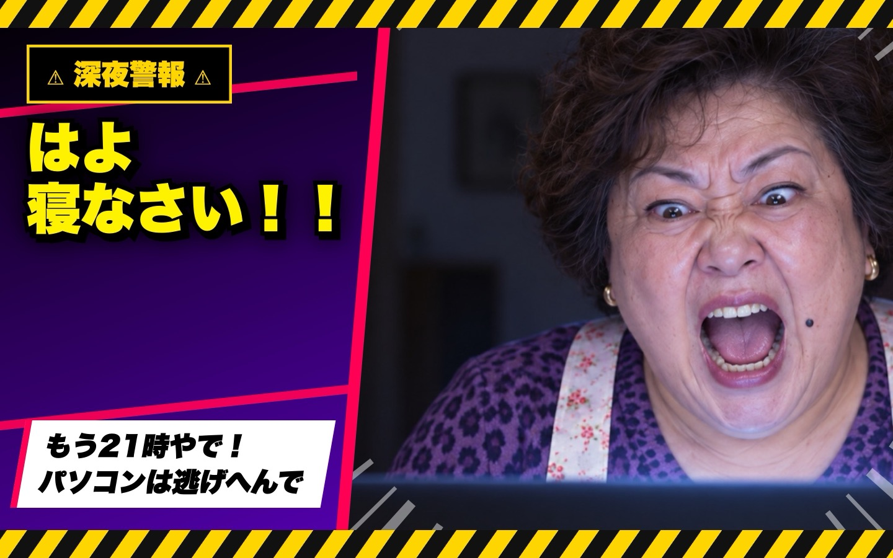

# 👵 おかんMod — Claudeを、おかんにした。

Claude Code に「関西のおかん」を住まわせる Mod です。
夜ふかしを叱り、同じお願いにツッコみ、時間になったら画面いっぱいに乱入してきます。
うるさい。けど、ちょっと便利です。



Claude Build Night Tokyo（2026-10-15）の LT で発表しました。
作者は非エンジニアで、Claude に日本語で頼んで作りました。

## 入れ方

ターミナルで Claude Code を開き、入力欄に次の1行を打ちます。

```
/plugin install okan --marketplace syunkuro123/okan-mod
```

1. 「Add marketplace?」と聞かれたら `y`
2. 入れる範囲を選ぶ画面では、そのまま Enter（自分のすべての会話で使う）
3. 「Installed okan」と出たら完了です

デスクトップアプリの Code タブでは、この1行は使えません。
ターミナルで入れておけば、デスクトップアプリでもおかんが出てきます。

## おかんが出てくるとき

| きっかけ | おかん |
|---|---|
| 7:00 | 起きなさい！！ 遅刻するで！ |
| 12:00 | お昼やで！！ ちゃんと食べなさい！ |
| 15:00 | おやつやで！！ ちょっと休憩し！ |
| 18:30 | ご飯できたで！！ 冷めるやろ！ |
| 20:00 | お風呂入りなさい！！ お湯冷めるで！ |
| 21:00〜 | はよ寝なさい！！（何か送るたびに） |
| 同じお願いを2回した | さっきも言うてたやん！ |
| 「やっぱり」と言った | やっぱり○回目やで（10回で「仕様変更の鬼」） |
| Claude の作業が終わった | えらいっ！！ ご飯できてるで |
| 作業中（ときどき） | ちょっと！！ 洗濯物取り込んで！ など |
| カメラ：画面に近い | 画面近い！！ 目ぇ悪なるで！ |
| カメラ：猫背 | 背中！！ まがってるで！ |
| カメラ：よそ見 | どこ見てんの！！ こっち見なさい！ |
| カメラ：目を閉じた | 寝るなら布団！！ 風邪ひくで！ |

時報は1日1回ずつです。

## 合図（入力欄に打つ）

| 合図 | すること |
|---|---|
| `/okan-demo` | デモ画面を開く。ボタンで全部の演出を試せる |
| `/okan` | 今すぐおかんを乱入させる |
| `/okan-camera on` / `off` | 内カメラの見張りを始める / やめる |
| `/okan-yoru on` / `off` / `auto` | 夜モード（auto は 21時から） |
| `/okan-zengamen on` / `off` | 画面いっぱいの乱入をする / しない |
| `/okan-oto on` / `off` | 音と声を出す / 出さない |
| `/okan-reset` | おかんの記憶（ツッコミ・やっぱり回数）を消す |

## 動く環境

- **Mac**：すべての機能が動きます
- **Windows・Linux**：画面いっぱいの乱入、声、カメラは動きません。Claude の入力欄の上に出る帯と、ツッコミだけが動きます

### カメラの見張りについて（Mac）

- 最初に `/okan-camera on` を打つと、「おかんカメラ がカメラにアクセスしようとしています」と聞かれます。「許可」を押してください
- 映像はこのMacの中だけで使います。保存も送信もしません
- 「開発元が未確認のため開けません」と出たときは、おかんModのフォルダにある `camera/build.sh` を実行して、自分のMacで組み立て直してください（Xcode のコマンドラインツールが必要です）。フォルダの場所は `claude plugin list` の表示で確認できます

```
sh <おかんModのフォルダ>/camera/build.sh
```

## 中身

| 場所 | 中身 |
|---|---|
| `hooks/register.tsx` | おかんの本体（いつ・何を言うか） |
| `hooks/screen.ts` | 画面いっぱいのカットイン |
| `hooks/voices.ts` | セリフと声のファイルの対応 |
| `camera/` | 内カメラの見張り（Mac の顔認識を使用） |
| `scenes/okan/` | おかんの写真 30枚 |
| `voices/` | おかんの声 43セリフ |
| `sounds/` | 効果音（ドドン・バシッ・キラキラ） |

## おかんのキャラクター


紫のヒョウ柄カーディガン、白地に赤い小花柄のエプロン、口元のほくろ、金のイヤリング。
このシートを見本にして、全部のシーンを同じおかんで作りました。

## 素材について（大事）

- **写真**：Codex（ChatGPT Images）で作った AI 生成画像です。実在の人物ではありません
- **声**：ElevenLabs（Lily）で作った AI 音声です。無料プランで作ったため、**商用利用はできません**。お金をとる場面で使うときは、ElevenLabs の有料プランで作り直してください
- **効果音**：プログラムで合成したオリジナルです

## 作り方

全部、Claude Code に日本語で頼んで作りました。

- Claude Code の Mods（Claude の画面や動きを改造する仕組み）
- Codex（画像生成）：キャラクターシート → 30シーン
- ElevenLabs（音声）：おばさん声のセリフ
- Mac の顔認識（Vision）：カメラの見張り

作者：すん（宮田 俊）
